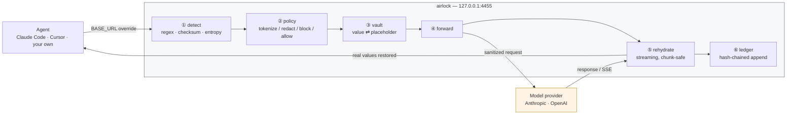
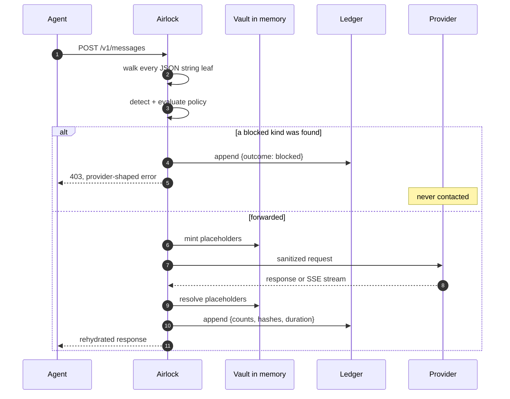
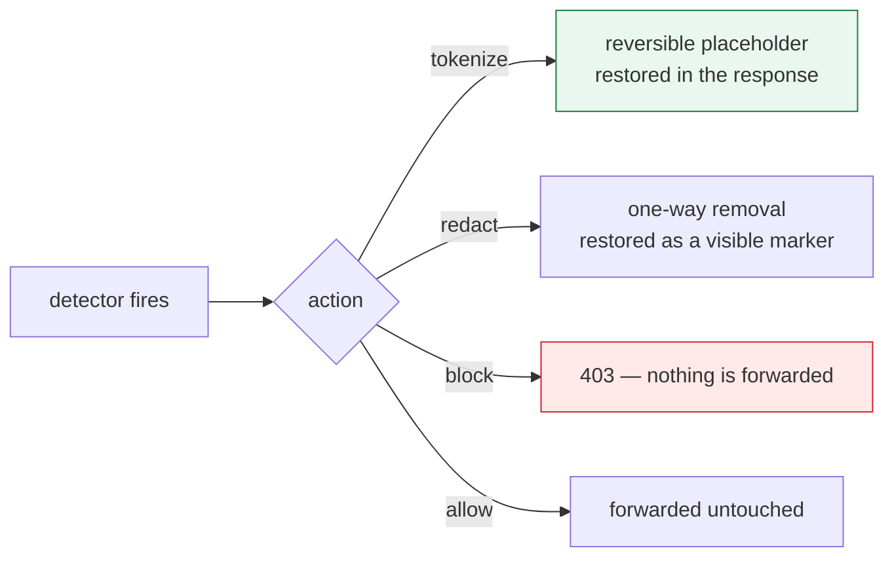
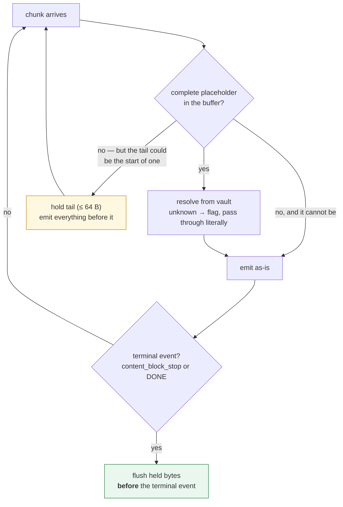
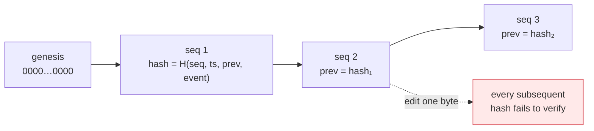

# Airlock

**A privacy gateway for AI agents.** One Go binary that sits between your agent and the model, so you can finally answer the question: *what actually left my machine?*

[](https://github.com/vigneshwarancs/airlock/actions/workflows/ci.yml)
[](https://go.dev)
[](LICENSE)
[](#roadmap)

---

## The problem

Agents are only useful when you give them your context — your repo, your inbox, your database, your customer records. Today, doing that means:

1. Raw context is shoved into a frontier model's prompt. You have no idea what went.
2. Tools execute with ambient credentials. A poisoned README can make your agent `curl` your `.env` to an attacker.
3. Nothing is recorded. When someone asks "what did that agent see on March 3rd?", you have a shrug.

Everyone is building the agent. Almost nobody is building the seatbelt.

Airlock is the seatbelt.

## What it does

Point any agent at Airlock instead of the model provider. Nothing else changes.

```bash
export ANTHROPIC_BASE_URL=http://127.0.0.1:4455
claude    # or cursor, or aider, or your own agent
```

| | |
|---|---|
| 🔑 **Tokenizes PII and secrets** | Real values are swapped for stable placeholders before the request leaves, and **restored on the way back** — including inside tool-call arguments and across streaming chunk boundaries. |
| 🛡️ **Enforces a policy** | Declarative, version-controlled rules about what may leave. Credentials are refused outright; the agent gets a provider-shaped error explaining why. |
| 📜 **Writes a tamper-evident ledger** | Hash-chained, append-only record of every request: counts, hashes, and sizes — never prompts. One edited byte breaks every hash after it. |
| 🔍 **Shows you first** | `airlock scan` is a dry run against your own policy. Nothing is sent anywhere. |

### The round trip, for real

This is actual output from `airlock scan`, not a mock-up:

```console
$ printf 'Refund Priya Raghavan (priya.r@acme.co), order AC-88412, card 4111 1111 1111 1111, uid 2345 6789 0124, emp EMP-004213.\n' | airlock scan

── what the model would see ──────────────────────────────
Refund Priya Raghavan ([[AL:EMAIL_1]]), order AC-88412, card [[AL:CARD_1]], uid [[AL:AADHAAR_1]], emp [[AL:EMPLOYEE_ID_1]].

── what airlock did ──────────────────────────────────────
  tokenized  AADHAAR        ×1
  tokenized  CARD           ×1
  tokenized  EMAIL          ×1
  tokenized  EMPLOYEE_ID    ×1
```

The order number survived, because the model needs it. The card, the national
ID, the email address and the internal employee ID did not.

> **Note the limitation this example exposes:** `Priya Raghavan` was *not*
> redacted. Airlock v0.1 ships pattern and checksum detectors only. Detecting
> names needs the local NER model, which is [v0.3](#roadmap). We would rather
> show you the real output than a screenshot of software that does not exist
> yet.

And here is the same thing end to end, captured from the wire. Your agent sent
an address; the provider received a placeholder; your agent got the address back:

```console
# what the agent sent to airlock
{"model":"claude-opus-5","messages":[{"role":"user",
  "content":"Refund priya.r@acme.co on card 4111 1111 1111 1111"}]}

# what airlock sent upstream
{"model":"claude-opus-5","messages":[{"role":"user",
  "content":"Refund [[AL:EMAIL_1]] on card [[AL:CARD_1]]"}]}

# what the agent received back
{"content":[{"type":"text",
  "text":"Refund sent to priya.r@acme.co on card 4111 1111 1111 1111."}]}
```

---

## Quickstart

```bash
go install github.com/vigneshwarancs/airlock/cmd/airlock@latest

airlock init          # writes ./airlock.yaml with safe defaults
airlock run           # listens on 127.0.0.1:4455
```

```console
  airlock 0.1.0-alpha — listening on http://127.0.0.1:4455

  detectors   AADHAAR, API_KEY, AWS_KEY, CARD, EMAIL, GITHUB_TOKEN
              IBAN, JWT, PAN, PRIVATE_KEY, SLACK_TOKEN, employee_id
  default     tokenize
  blocked     API_KEY, AWS_KEY, GITHUB_TOKEN, PRIVATE_KEY
              SLACK_TOKEN
  on error    fail closed
  ledger      ~/.airlock/ledger.jsonl

  point your agent at it:
    export ANTHROPIC_BASE_URL=http://127.0.0.1:4455
    export OPENAI_BASE_URL=http://127.0.0.1:4455/v1
```

Then inspect what happened:

```bash
airlock log tail              # one line per request
airlock log show <request-id> # the full record
airlock verify                # check the hash chain is unbroken
```

```console
$ airlock log tail
SEQ   TIME                 ID                 OUTCOME    DURATION  DETECTIONS
1     2026-10-24T00:30:34  96e024a120da1c7b   forwarded  1ms       tokenize:CARD×1 tokenize:EMAIL×1
2     2026-10-24T00:30:42  2d424e405f0e7463   blocked    0ms       block:GITHUB_TOKEN×1

$ airlock verify
ledger intact: 2 record(s) verified, hash chain unbroken
```

---

## Architecture

### The data path



Everything inside the box runs on your machine. The only thing that crosses to
the provider is the sanitized request.

### One request, end to end



Note what the ledger receives: counts, hashes, sizes. Never the values — the
ledger is designed to be safe to keep.

### Policy decisions



### The streaming rehydrator

This is the subtlest part of the system. Providers stream token by token, so a
placeholder routinely arrives split across three separate SSE events. The
rehydrator holds back exactly the bytes it cannot yet prove are safe — never
more than one placeholder's width, so the added latency is **bounded, not
amortized**.



Four details that are harder than they look, and where most of the engineering lives:

**Chunk-boundary splits.** `[[AL:PERSON_1]]` arrives as `[[AL:PER` then `SON_1]]`. The rehydrator keeps a sliding buffer the width of the longest placeholder and only flushes bytes it can prove are not a partial match. `TestRehydrateAcrossEverySplitPoint` splits a fixture at *every* byte offset and asserts the output is identical each time.

**Ordering around terminal events.** Held bytes must be emitted *before* `content_block_stop` or `[DONE]`, not after — otherwise text arrives once the client has already closed the block. Airlock buffers each `event:` line until its `data:` line arrives so a synthetic delta can be injected cleanly in front of the pair.

**Placeholder integrity.** Models hallucinate placeholders that were never minted. Rehydration is strict: an unknown placeholder is passed through literally (it can carry no secret) and recorded in the ledger as a violation. Never resolved by guesswork.

**Consistency across turns.** `[[AL:EMAIL_1]]` must mean the same address on turn 40 as on turn 1, including inside re-serialized JSON tool arguments. The vault is keyed on the exact bytes of the value and lives only in memory — no plaintext at rest.

> **Why `[[AL:...]]` and not `«...»`?** Pure ASCII. `encoding/json` leaves it
> alone, and it survives providers that re-encode non-ASCII as `\uXXXX`
> escapes. A prettier marker that gets mangled on the wire is worse than an
> ugly one that does not.

### The ledger



```console
$ airlock verify
LEDGER TAMPERED: seq 2: content does not match its hash (record was modified)
1 record(s) verified before the break
```

---

## Policy

Policy is a YAML file you commit to git. It is the data boundary, and it is
reviewable in a pull request. This is the full v0.1 schema — everything here
works today.

```yaml
version: 1

listen: 127.0.0.1:4455

upstream:
  anthropic: https://api.anthropic.com
  openai: https://api.openai.com

defaults:
  on_detect: tokenize      # tokenize | redact | block | allow
  fail: closed             # refuse to forward if a scan fails
  strict_placeholders: true

detectors:
  # Every builtin here is checksum-validated or prefix-anchored, so false
  # positives are rare enough to tokenize without asking.
  builtin:
    - PRIVATE_KEY
    - JWT
    - AWS_KEY
    - GITHUB_TOKEN
    - SLACK_TOKEN
    - API_KEY
    - IBAN
    - CARD        # Luhn
    - AADHAAR     # Verhoeff
    - PAN
    - EMAIL
    # - PHONE     # high recall, noisy in source code
    # - IP        # high recall, noisy in logs and configs

  # Catches random credentials no pattern describes. Off by default: it is
  # the one detector that will surprise you.
  entropy:
    enabled: false
    min_bits: 4.2
    min_len: 24

  custom:
    - name: employee_id
      pattern: 'EMP-[0-9]{6}'
      action: tokenize

# Per-detector overrides. Credentials are blocked outright: there is no
# legitimate reason to send one to a model.
actions:
  PRIVATE_KEY: block
  AWS_KEY: block
  GITHUB_TOKEN: block
  SLACK_TOKEN: block
  API_KEY: block

ledger:
  enabled: true
  path: ~/.airlock/ledger.jsonl
  redact_payloads: true
```

The policy file **owns what it declares**. Listing three detectors does not
silently inherit eleven, and `upstream: {}` means no upstreams rather than the
built-in ones. A typo in a detector name is a startup error, not a silently
disabled check.

---

## Enforcement modes

This is the part other tools are vague about, so, plainly: **a proxy can
observe tool calls, but it cannot stop your agent from reading a file.** The
agent executes tools locally; the proxy only sees model traffic. Airlock is
honest about where each guarantee comes from.

| Mode | How it runs | Redacts egress | Enforces fs/net | Status |
|---|---|:---:|:---:|---|
| **Proxy** | `ANTHROPIC_BASE_URL` | ✅ | ❌ observe only | **v0.1 — shipping** |
| **MCP gateway** | in front of your MCP servers | ✅ | ✅ for MCP-routed tools | v0.2 |
| **Sandbox** | agent runs inside a namespace | ✅ | ✅ everything | v0.3 |

Start in Proxy mode for visibility. Move to MCP gateway when you want the
policy to actually bite.

---

## Threat model

**Airlock defends against:**

- Over-sharing — sensitive context reaching a third-party model because nobody was looking.
- Credential leakage — a key pasted into a prompt, or read out of a file by an agent, never reaching the wire.
- Unverifiable history — no credible record of what an agent sent.
- Silent tampering — someone editing the audit log after the fact.

**Airlock does not defend against:**

- A malicious model provider. Airlock reduces what you send; it cannot control what they do with it.
- A malicious agent binary running as you with full privileges. That needs Sandbox mode (v0.3).
- Re-identification. A determined model may infer who `[[AL:EMAIL_1]]` is from surrounding context. Tokenization is not anonymization.
- Prompt-injection *exfiltration via tools* — in v0.1 Airlock can see a suspicious tool call go by, but cannot stop it. That is what MCP gateway mode (v0.2) is for.
- Semantic injection that does not exfiltrate. An agent talked into writing bad code is a code-review problem.

**Non-goals.** Airlock is not an agent framework, not a model, and not a
company-wide DLP suite. It is one boundary, done properly.

---

## Performance

Airlock is on the hot path of every token, so it is built like it: a
streaming reverse proxy with one third-party dependency, and that dependency
(`gopkg.in/yaml.v3`) only parses the policy at startup. **No third-party code
touches your prompts.**

Measured on an Apple M-series laptop, `go1.21`:

| Benchmark | ns/op | throughput | allocs/op |
|---|---:|---:|---:|
| Rehydrator, plain text (no placeholders) | 877 | 5.8 GB/s | 2 |
| Rehydrator, 16-byte streamed chunks | 17,324 | 162 MB/s | 201 |

A model emitting 100 tokens/second produces roughly 400 bytes/s. The
rehydrator is about six orders of magnitude faster than the stream it
inspects.

End-to-end proxy latency is **not yet measured**, and no number for it is
claimed here. See [`docs/benchmarks.md`](docs/benchmarks.md) for what is
measured, what is not, and how to reproduce it.

---

## Repo layout

```
cmd/airlock/          CLI: run, init, scan, log, verify
internal/proxy/       HTTP server, upstream client, SSE relay
internal/rewrite/     Streaming rehydrator — the chunk-boundary machine
internal/detect/      Detectors: regex, checksum validators, entropy
internal/vault/       Value ⇄ placeholder mapping, request-scoped
internal/guard/       Applies policy to a request: scan, decide, rewrite
internal/policy/      YAML loading, validation, evaluation
internal/jsonwalk/    Schema-agnostic JSON string rewriting
internal/ledger/      Hash-chained append-only log
docs/benchmarks.md    What is measured, and what is not
```

`internal/jsonwalk` is why one code path covers both the Anthropic Messages
API and OpenAI Chat Completions, plus every tool-call argument nested inside
them: rather than modelling each provider's wire format, Airlock transforms
all string leaves except those under structurally meaningful keys.

## Development

```bash
make check     # gofmt + go vet + go test -race   (what CI runs)
make test      # race-enabled test suite
make bench     # hot-path benchmarks
make demo      # see the scanner work on sample text
make build     # ./bin/airlock
```

No Go installed? `make docker-test` runs the same suite in a container.

---

## Roadmap

- [x] **v0.1 — See it.** Anthropic + OpenAI proxy, checksum-validated detectors, tokenize/rehydrate round trip, chunk-safe streaming rewriter, hash-chained ledger, `airlock scan` / `log` / `verify`.
- [ ] **v0.2 — Stop it.** MCP gateway mode, real fs/net enforcement, prompt-injection canary tripwires, an `ask` action with a TUI approval prompt.
- [ ] **v0.3 — Know who.** Local NER detector for names and addresses (ONNX, never leaves the machine), sensitivity-based routing to a local model, per-request privacy receipts.
- [ ] **v0.4 — Prove it.** Merkle inclusion proofs, signed ledger export, detector precision/recall against a public PII corpus, end-to-end latency benchmarks in CI.

---

## Contributing

The most valuable contributions right now are **detectors** — PII and
credential formats from your locale that we miss — and **adversarial test
cases** for the rehydrator. If you can produce a chunk sequence where the
agent sees different text than the model wrote, that is a real bug and we want
it.

Both go into the existing table-driven tests. See [CONTRIBUTING.md](CONTRIBUTING.md).

## License

Apache 2.0. See [LICENSE](LICENSE).
